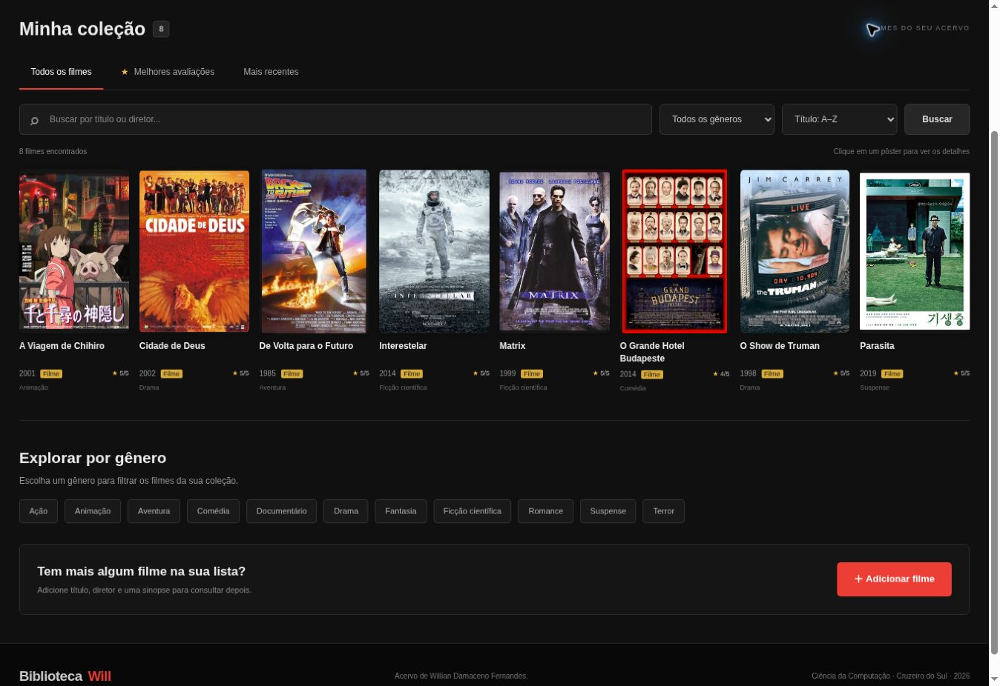

# Biblioteca Will

Catálogo pessoal de filmes desenvolvido em Java, com interface web e persistência em banco de dados H2. Projeto acadêmico de Ciência da Computação, com foco em orientação a objetos, desenvolvimento web e acesso a dados.



## Funcionalidades

- Cadastro de filmes com título, diretor, ano, gênero e sinopse.
- Listagem e consulta dos detalhes de cada filme.
- Edição e exclusão com confirmação.
- Busca por título ou diretor.
- Filtro por gênero e ordenação por título, ano ou avaliação.
- Avaliação opcional de zero a cinco estrelas.
- Persistência em arquivo local e oito filmes de exemplo na primeira inicialização.

## Tecnologias

Java 17, Jakarta Servlet, JSP, JDBC, H2, Tomcat incorporado, Maven, JUnit 5, HTML, CSS e JavaScript.

## Como executar

Instale o **JDK 17 ou superior** e o **Maven**. Abra o terminal na pasta que contém `pom.xml` e compile:

```sh
mvn clean package
```

O comando executa os testes e gera as classes, o WAR e as dependências de execução. Este repositório contém o código-fonte; os arquivos compilados são gerados localmente.

No Windows, abra `iniciar.bat` ou execute na pasta do projeto:

```bat
java -cp "target\classes;target\dependency\*" br.edu.cinearquivo.Main
```

No Linux ou macOS:

```sh
sh iniciar.sh
```

Acesse **http://localhost:8080/filmes**. Mantenha o terminal aberto; `Ctrl+C` encerra o servidor. O pacote interno `br.edu.cinearquivo` foi mantido por compatibilidade.

Se a porta estiver ocupada, execute no Windows:

```bat
java -Dcine.port=8081 -cp "target\classes;target\dependency\*" br.edu.cinearquivo.Main
```

Nesse caso, acesse http://localhost:8081/filmes.

## Organização

```text
src/main/java/br/edu/cinearquivo/
  model/       Entidade Filme
  dao/         Acesso ao banco com JDBC
  service/     Regras e validações
  web/         Controle HTTP e proteção de saída
  config/      Inicialização e conexões
src/main/webapp/   Páginas JSP e arquivos da interface
src/main/resources/   Esquema e exemplos do banco
src/test/         Testes JUnit
docs/             Diagramas, capturas e registros de verificação
```

A Servlet recebe as requisições, o serviço valida os dados e o DAO concentra o SQL. As JSPs apresentam os formulários e o catálogo.

## Testes

```sh
mvn test
```

Com a aplicação em execução e Python 3 instalado, os cenários HTTP podem ser executados com:

```sh
python docs/teste_http.py http://localhost:8080
```

Use uma instância dedicada para testes. Confira o script antes de executá-lo em um acervo que deseja preservar.

Os registros históricos incluídos documentam sete testes JUnit aprovados na versão original e 20 cenários HTTP aprovados na revisão de 28/10/2026. Eles não representam uma nova execução nesta preparação para o GitHub. Consulte [os detalhes da verificação](docs/VERIFICACAO.md).

## Dados e escopo

O banco é criado em `data/catalogo.mv.db` e não é versionado. Para fazer backup, encerre o servidor e copie a pasta `data`. Os exemplos são carregados uma única vez.

A aplicação destina-se a uso local e escuta em `127.0.0.1` por padrão. Não possui autenticação. Uma implantação pública exige revisão de segurança e infraestrutura. O GitHub armazena o código; o GitHub Pages não executa este servidor Java.

As consultas usam `PreparedStatement`, a saída HTML recebe escape e os envios de formulário exigem token CSRF. Essas medidas não equivalem a uma auditoria completa de segurança.

## Documentação e imagens

- [Casos de uso](docs/casos-de-uso.svg)
- [Classes](docs/classes.svg)
- [Modelo de dados](docs/modelo-de-dados.svg)
- [Fontes das capas](docs/FONTES-CAPAS.md)
- [Dependências e materiais de terceiros](THIRD-PARTY.md)

Os pôsteres pertencem aos respectivos titulares. Este repositório não concede licença sobre essas imagens ou sobre as dependências de terceiros.

## Autor

Willian Damaceno Fernandes.
